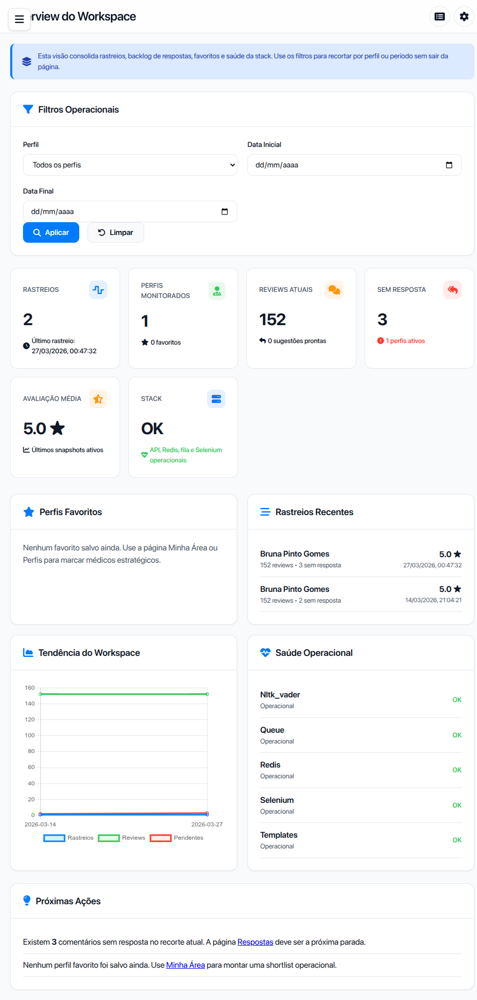
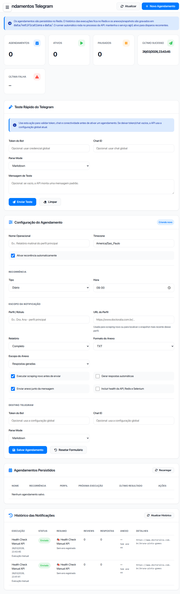

[Wiki Home](Home.md) · [Quickstart](quickstart.md) · [Telegram Notifications](telegram-notifications.md) · [Operations](operations.md)

# Dashboard Workspace

<table>
  <tr>
    <td width="50%">
      
    </td>
    <td width="50%">
      
    </td>
  </tr>
</table>

## O papel do dashboard

O dashboard é a mesa de operação do projeto. Ele organiza o que no backend já existe, mas de forma navegável para o operador:

- login web com sessão assinada e redirecionamento para rotas protegidas
- visão consolidada de perfis, reviews, pendências e saúde
- fila de respostas sugeridas
- gestão de favoritos, preferências e credenciais do operador
- inventário e limpeza de snapshots
- relatórios operacionais
- configuração central
- agendamentos Telegram com histórico

## Rotas principais

| Rota | Função |
|---|---|
| `/login` | Entrada autenticada do dashboard |
| `/` | Overview do workspace |
| `/profiles` | Recorte por perfil e histórico recente |
| `/responses` | Fila de comentários sem resposta |
| `/history` | Snapshots persistidos e limpeza |
| `/reports` | Inventário, timeline e relatórios |
| `/me` | Perfil do operador, favoritos e troca de senha |
| `/settings` | Configuração central |
| `/notifications/telegram/schedule` | Scheduler Telegram |
| `/health-check` | Leitura operacional da stack |

## Datas e paginação

O workspace distingue duas datas:

- **Data da coleta** (`scraped_at` do snapshot): os parâmetros `date_from` e `date_to` de `/api/workspace/*` escolhem snapshots por ela. Overview, histórico, relatórios e perfis continuam usando esse recorte.
- **Data da avaliação** (publicação na Doctoralia): `review_date_from` e `review_date_to` em `/api/workspace/responses` e `/api/workspace/profile` filtram avaliações por ela. A data é comparada no fuso informado pela origem (`2026-01-10T23:30-03:00` é 10 de janeiro). Avaliações sem data publicada ficam fora de qualquer filtro de data da avaliação e são contadas em `summary.undated_excluded`; elas nunca recebem a data da coleta.

Cada item da fila traz `review_date` (data da avaliação, `AAAA-MM-DD` ou `null`) e `collected_at` (coleta do snapshot).

`/api/workspace/responses` aceita `page` (a partir de 1) e `page_size` (1–100; padrão 25 quando só `page` é informado). A resposta inclui `pagination` com `page`, `page_size`, `total_items` e `total_pages`; `summary` sempre conta a fila filtrada inteira. Sem `page` e `page_size`, todos os itens são devolvidos, como antes. Valores inválidos são ajustados ao intervalo válido.

Os snapshots lidos do disco ficam em cache por processo, invalidado por inode, tamanho e `mtime` de cada arquivo.

## Autenticação do dashboard

Quando `dashboard_auth_enabled` está ativo e existe uma credencial válida, o dashboard protege as rotas web e redireciona para `/login`.

- usuário esperado: `config/config.json > user_profile.username`
- senha inicial de bootstrap: `API_KEY`, enquanto ainda não existir `dashboard_password_hash`
- senha dedicada: passa a valer depois da primeira rotação feita em `/me`
- sessão: cookie Flask assinado com TTL controlado por `dashboard_session_ttl_minutes`

## Área `/me`

O card `Segurança & Login` em `/me` cobre:

- leitura do estado atual de autenticação
- indicação visual de bootstrap ativo vs. senha dedicada
- troca de senha do dashboard
- feedback inline para senha atual incorreta, confirmação divergente e regra mínima
- medidor visual de força da nova senha com checklist das regras exibidas na UI

## Como os dados aparecem na UI

O dashboard trabalha principalmente sobre snapshots em `data/`.

1. O worker conclui um scraping válido.
2. O resultado é normalizado.
3. Um snapshot JSON é salvo.
4. O dashboard passa a enxergar esse perfil em overview, profiles, responses, history e reports.

Se o job falhar antes de salvar snapshot, o perfil não entra no workspace.

Uma coleta parcial ou não verificada aparece no histórico como tal. Quando há um snapshot completo anterior, ele continua sendo a referência dos dados atuais; a limpeza automática de snapshots antigos não remove snapshots parciais. O scheduler não envia como relatório completo uma coleta nova ou um snapshot identificado como parcial. Snapshots legados sem metadados de completude continuam disponíveis, mas sua completude não foi verificada retroativamente.

Os rascunhos permanecem em JSON. Na coleta seguinte, são preservados por ID da Doctoralia ou por correspondência única de autor e comentário. Casos ambíguos e rascunhos presentes somente em snapshots mais antigos exigem conferência. A publicação é atômica e os processos atualizados compartilham um bloqueio; atualize API, worker e dashboard juntos para que todos participem dele.

## Modos de geração disponíveis

| Modo | Uso |
|---|---|
| `local` | templates e heurísticas locais |
| `openai` | usa `OPENAI_API_KEY` |
| `gemini` | usa `GEMINI_API_KEY` ou `GOOGLE_API_KEY` |
| `claude` | usa `CLAUDE_API_KEY` ou `ANTHROPIC_API_KEY` |

Os parâmetros expostos em `/settings` incluem:

- modo padrão
- modelo por provedor
- `temperature`
- `max_tokens`
- `system_prompt`

## Scheduler Telegram dentro do dashboard

O bloco `/notifications/telegram/schedule` cobre:

- teste manual de conectividade com o bot
- criação e edição de recorrências
- escolha de scraping novo ou reaproveitamento de snapshot
- geração opcional de respostas
- anexos em múltiplos formatos
- health da stack junto do relatório
- histórico persistido das execuções

## Fluxo operacional recomendado

1. Configure chaves e providers em `/settings`.
2. Rode um scraping inicial para popular snapshots.
3. Priorize perfis em `/profiles` e `/me`.
4. Trate a fila em `/responses`.
5. Use `/reports` para entender acúmulo, storage e evolução.
6. Agende relatórios ou health checks em `/notifications/telegram/schedule`.

## Quando algo parece "sumir"

| Sintoma | Verificar |
|---|---|
| Perfil não aparece no workspace | Se o snapshot foi salvo em `data/` |
| Histórico vazio | Se houve execução válida ou prune agressivo |
| Respostas pendentes zeradas do nada | Se o snapshot mais recente realmente contém reviews sem resposta |
| Agendamentos não disparam | Se a API está rodando e o `next_run_at` está correto |

## Próximas leituras

- [Telegram Notifications](telegram-notifications.md)
- [Operations](operations.md)
- [API REST](api.md)
